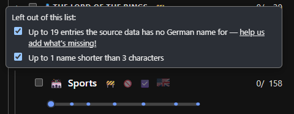

# Contributing

Thanks for helping with the project!

Most of our word lists are built from [Wikidata](https://www.wikidata.org/), which is asked to deliver [every language Skribbl.io supports](https://skribbl-io.fandom.com/wiki/Supported_Languages) (and a few more) in a single dump. Those lists themselves therefore need no per-language work (locally); only the interface (the Locales) has to be extended when a new UI language is added.  
So the **most effective help** happens there: a label or an item added on **Wikidata** reaches the app with the next data dump, in that language and for everyone else using Wikidata too.

## Table of Contents

- [**What's worth contributing**](#whats-worth-contributing)
- [**Improve the data on Wikidata** (recommended)](#improve-the-data-on-wikidata-recommended)
  - [Improve Wikidata data beyond Labels](#improve-wikidata-data-beyond-labels)
- [**Propose a topic** built from Wikidata](#propose-a-topic-built-from-wikidata)
  - [Request a topic (less technical)](#request-a-topic-less-technical)
  - [Propose a topic based on a Wikidata Query (technical)](#propose-a-topic-based-on-a-wikidata-query-technical)
- [Corrections](#corrections)
- [Hand-written lists (not recommended)](#hand-written-lists-not-recommended)
- [**Looking for UI proofreaders**](#looking-for-ui-proofreaders--spanish-french-italian-japanese-korean-chinese-russian-portuguese) (Spanish, French, Italian, Japanese, Korean, Chinese, Russian, Portuguese)
- [Local development](#local-development)
- [Questions & discussion](#questions--discussion)

## What's worth contributing

- **Missing names on Wikidata** for a topic that is already built from it: a label in your language, a missing item, a wrong statement.
- **A new topic, or a change to one, that Wikidata can carry:** say which items belong to it and which don't (based on Wikidata Statements).
- **A wrong entry** in a list, or one that sits in the wrong fame tier.
- Anything about the **tool itself**: a bug, or an idea for how it could work better.
- **Proofreading** one of the machine-written interface languages.

<!-- Might at some point be worth replacing with docs/Queries/README.md ... or simple cross-linking might already be enough, since they both serve different purposes -->
The [topic tracker](docs/Topic-Progress.md) shows what's already covered and what's planned. Worth a look before proposing a new topic.

## Improve the data on Wikidata (recommended)

On a Topic built from Wikidata, you may find an **Omission entry** mentioning "items with no \<language\> names", followed by a "help us add what's missing!" with a URL behind:  
  
<!-- Example coverage page: Sports for now; swap for South Park, One Piece or a similar topic once one of those is built from Wikidata. -->
This URL leads you to a page that presents you a table showing the **language Coverage** across ALL items coming from the Wikidata Dump this Topic is built from[1]; Take [Sports](https://trummler12.github.io/custom-wordlists/coverage/sports) as an example;  
A red "✗" marks a label that's not defined yet;  
You may also navigate to other Topics' Coverage Pages via the "Topic:" selector in the top right;  
Every Topic built from Wikidata has such a Coverage Page.

Open an item from the table and, once logged in to Wikidata, add what's missing. The page's "How to help" notes cover the most important details. A few ground rules:

- Only add what you're sure of, ideally based on a trustworthy source.
- Fix a gap on Wikidata rather than asking us to work around it: a fix there helps every project that reads the data.
- Our dumps are run by hand, so a fix takes a while to show up in the app.

[1] Note: Most Topics have their own Dump, but some exceptions share a Dump with other sibling topics, `sports/games/<game>/sports` being such an example.

### Improve Wikidata data beyond Labels

It's perfectly fine when most contributors **limit** themselves **to updating labels** since that's where the majority of all manual work takes place;  
And even though this Application doesn't use them, you're happily invited to **update Description, Aliases and unrelated Statements as well** when you're already at it (ideally with a source/reference at hand), since they're often either empty/missing, inconsistent or confusing ^^

Now, when it comes to **Statements**, it starts to become increasingly technical, but in case you're still interested, here are the most important statements worth updating:

- **[official name (P1448)](https://www.wikidata.org/wiki/Property:P1448)**: Mainly serves as a basis for "long" variants on some (non-real-human) items,
  - with "[start time (P580)](https://www.wikidata.org/wiki/Property:P580)" and "[end time (P582)](https://www.wikidata.org/wiki/Property:P582)" as optional qualifiers in case the item underwent a renaming (for example on Countries such as ["White Russia"/"Belarus"](https://www.wikidata.org/wiki/Q184) or on [LoL Champions with a legacy name](https://www.wikidata.org/wiki/Q100255168));
- **[short name (P1813)](https://www.wikidata.org/wiki/Property:P1813)**: Serves as a basis for "short" variants;
- **[family name (P734)](https://www.wikidata.org/wiki/Property:P734)** & **[given name (P735)](https://www.wikidata.org/wiki/Property:P735)**,
  - with "[series ordinal (P1545)](https://www.wikidata.org/wiki/Property:P1545)" in cases with multiple given and/or family names;
- **[pseudonym (P742)](https://www.wikidata.org/wiki/Property:P742)** for the name of an alternate persona (for example as a hero, villain or artist)

^That covers pretty much everything we rely on in terms of **_quality_** (the names used in our lists);  

The **_quantity_** on the other hand relies on the completeness of the items themselves as well as their Statements we filter based on; And what those Statements (+even Qualifiers in some cases) _are_ differs from Topic to Topic;  
However: the _logical_ completeness and correctness of the data is often highly objective and easy to check automatically via test query scripts, which makes it a task well suited to an AI agent. But an agent can't be let loose to hallucinate: any updates this way must carry the explicit instruction that the resulting [QuickStatements batches](https://quickstatements.toolforge.org/#/batch) only consist of data backed by a trustworthy, independent reference wherever a source makes sense.  
In case you're interested in some insight in this regard, you may check out the [landing 'page'](https://github.com/Trummler12/custom-wordlists/blob/docs/wikidata_analysis/docs/Queries/README.md) of this whole background analysis

## Propose a topic built from Wikidata

First, we need to know that before a topic is fully supported, it passes through a few stages:
<!-- Candidate list lives on PR #38's branch until it merges; switch to a relative docs/Queries/README.md link then. -->
1. it first shows up as a *Candidate* in the [Wikidata analysis](https://github.com/Trummler12/custom-wordlists/blob/docs/wikidata_analysis/docs/Queries/README.md),
2. gets promoted to an evaluation of its own,
3. and once it looks promising it turns into a planned, then a built topic (*Planned* and *Incomplete* are often skipped straight past).

The [topic tracker](docs/Topic-Progress.md) shows where each one stands, usually trailing the analysis and sometimes even the live Topics a little.

### Request a topic (less technical)

Not comfortable with technical stuff? Just name the topic you'd like via a [**Topic Request**](https://github.com/Trummler12/custom-wordlists/issues/new?template=0-topic-request.yml) issue, or 👍 an [existing one](https://github.com/Trummler12/custom-wordlists/issues?q=is%3Aissue+state%3Aopen+label%3A%22Topic+Request+%F0%9F%97%B3%EF%B8%8F%22) to show anticipation.  
No query needed, and it is also how a [topic still in the analysis phase](https://github.com/Trummler12/custom-wordlists/blob/docs/wikidata_analysis/docs/Queries/README.md#wikidata-query-analysis) can get moved forward more quickly.  
Please check first that it isn't already covered or requested (activate the app's "Show `all` topics", or check out the [topic tracker](docs/Topic-Progress.md)).

### Propose a topic based on a Wikidata Query (technical)

For the more technical approach, you may open a [**Data source**](https://github.com/Trummler12/custom-wordlists/issues/new?template=1-data-source.yml) issue;  
The best proposal names the query that finds the topic's items, ideally as a ready-made [Wikidata Query Builder](https://query.wikidata.org/querybuilder/) link:

- **"With"** conditions say what makes an item part of the topic: its class (*instance of*, `P31`), or the work or series it belongs to (*part of the series*, `P179`; *present in work*, `P1441`).
- **"Without"** conditions say what to leave out. [1]
- If something obvious can be used as an indicator for how well-known an item is (for example: population, number of sales), please mention it; otherwise we rank its "fame" by the number of Wikipedias covering an item.

[1] We also need to distinguish between 2 Types of "leaving out":
- **Base filtering** of actual noise that doesn't really fit the topic at all (not relevant in most cases);
- **"Omission" filtering**: Some types of items (classes) may fall outside of what the casual user may intuitively expect to be covered by the respective Topic (examples: _extinct_ languages, _historical_ countries, territories of _limited recognition_, _different forms_ of Pokémon, etc.); However: Instead of leaving them out, we usually put them into so-called "Omission Groups", which then show up in the Inclusion Panel ("✅", "☑️", etc.) or the Omission Panel ("🚫") as optional Sub-Topics which a user can _choose_ to include as well

<!-- Example query: the countries, which match our dump one to one; swap it along with the coverage example above if a better one turns up. -->
<!-- Once PR #38 has merged: link docs/Queries/README.md here, the analyses of what Wikidata covers per topic and how we file edits through QuickStatements. -->
For example, [this query](https://w.wiki/XnJo) finds the countries: sovereign states, without those that have a dissolution date.  
In case your Query increases in Complexity (example: [Pokémon](https://query.wikidata.org/querybuilder/?uselang=en&query=%7B%22conditions%22%3A%5B%7B%22propertyId%22%3A%22P31%22%2C%22propertyDataType%22%3A%22wikibase-item%22%2C%22propertyValueRelation%22%3A%22matching%22%2C%22referenceRelation%22%3A%22regardless%22%2C%22value%22%3A%22Q3966183%22%2C%22subclasses%22%3Atrue%2C%22conditionRelation%22%3Anull%2C%22negate%22%3Afalse%7D%2C%7B%22propertyId%22%3A%22P31%22%2C%22propertyDataType%22%3A%22wikibase-item%22%2C%22propertyValueRelation%22%3A%22matching%22%2C%22referenceRelation%22%3A%22regardless%22%2C%22value%22%3A%22Q56707595%22%2C%22subclasses%22%3Atrue%2C%22conditionRelation%22%3A%22and%22%2C%22negate%22%3Atrue%7D%2C%7B%22propertyId%22%3A%22P31%22%2C%22propertyDataType%22%3A%22wikibase-item%22%2C%22propertyValueRelation%22%3A%22matching%22%2C%22referenceRelation%22%3A%22regardless%22%2C%22value%22%3A%22Q72918110%22%2C%22subclasses%22%3Atrue%2C%22conditionRelation%22%3A%22and%22%2C%22negate%22%3Atrue%7D%2C%7B%22propertyId%22%3A%22P31%22%2C%22propertyDataType%22%3A%22wikibase-item%22%2C%22propertyValueRelation%22%3A%22matching%22%2C%22referenceRelation%22%3A%22regardless%22%2C%22value%22%3A%22Q108152260%22%2C%22subclasses%22%3Atrue%2C%22conditionRelation%22%3A%22and%22%2C%22negate%22%3Atrue%7D%2C%7B%22propertyId%22%3A%22P31%22%2C%22propertyDataType%22%3A%22wikibase-item%22%2C%22propertyValueRelation%22%3A%22matching%22%2C%22referenceRelation%22%3A%22regardless%22%2C%22value%22%3A%22Q16577590%22%2C%22subclasses%22%3Atrue%2C%22conditionRelation%22%3A%22and%22%2C%22negate%22%3Atrue%7D%2C%7B%22propertyId%22%3A%22P31%22%2C%22propertyDataType%22%3A%22wikibase-item%22%2C%22propertyValueRelation%22%3A%22matching%22%2C%22referenceRelation%22%3A%22regardless%22%2C%22value%22%3A%22Q113403839%22%2C%22subclasses%22%3Atrue%2C%22conditionRelation%22%3A%22and%22%2C%22negate%22%3Atrue%7D%2C%7B%22propertyId%22%3A%22P31%22%2C%22propertyDataType%22%3A%22wikibase-item%22%2C%22propertyValueRelation%22%3A%22matching%22%2C%22referenceRelation%22%3A%22regardless%22%2C%22value%22%3A%22Q56707539%22%2C%22subclasses%22%3Atrue%2C%22conditionRelation%22%3A%22and%22%2C%22negate%22%3Atrue%7D%5D%2C%22limit%22%3A2000%2C%22useLimit%22%3Atrue%2C%22omitLabels%22%3Afalse%7D), with all kinds of different Forms), you're welcome to also include a link to the [Base Query](https://w.wiki/iwuY) (without any Omissions) as well; and in some cases, there may even be other useful types of queries such as a [check to correctly filter out False Positives](https://query.wikidata.org/querybuilder/?uselang=en&query=%7B%22conditions%22%3A%5B%7B%22propertyId%22%3A%22P31%22%2C%22propertyDataType%22%3A%22wikibase-item%22%2C%22propertyValueRelation%22%3A%22matching%22%2C%22referenceRelation%22%3A%22regardless%22%2C%22value%22%3A%22Q3966183%22%2C%22subclasses%22%3Atrue%2C%22conditionRelation%22%3Anull%2C%22negate%22%3Afalse%7D%2C%7B%22propertyId%22%3A%22P4584%22%2C%22propertyDataType%22%3A%22wikibase-item%22%2C%22propertyValueRelation%22%3A%22matching%22%2C%22referenceRelation%22%3A%22regardless%22%2C%22value%22%3A%22Q27118928%22%2C%22subclasses%22%3Atrue%2C%22conditionRelation%22%3A%22and%22%2C%22negate%22%3Atrue%7D%2C%7B%22propertyId%22%3A%22P4584%22%2C%22propertyDataType%22%3A%22wikibase-item%22%2C%22propertyValueRelation%22%3A%22matching%22%2C%22referenceRelation%22%3A%22regardless%22%2C%22value%22%3A%22Q27118900%22%2C%22subclasses%22%3Atrue%2C%22conditionRelation%22%3A%22and%22%2C%22negate%22%3Atrue%7D%2C%7B%22propertyId%22%3A%22P4584%22%2C%22propertyDataType%22%3A%22wikibase-item%22%2C%22propertyValueRelation%22%3A%22matching%22%2C%22referenceRelation%22%3A%22regardless%22%2C%22value%22%3A%22Q27118889%22%2C%22subclasses%22%3Atrue%2C%22conditionRelation%22%3A%22and%22%2C%22negate%22%3Atrue%7D%2C%7B%22propertyId%22%3A%22P4584%22%2C%22propertyDataType%22%3A%22wikibase-item%22%2C%22propertyValueRelation%22%3A%22matching%22%2C%22referenceRelation%22%3A%22regardless%22%2C%22value%22%3A%22Q27118795%22%2C%22subclasses%22%3Atrue%2C%22conditionRelation%22%3A%22and%22%2C%22negate%22%3Atrue%7D%2C%7B%22propertyId%22%3A%22P4584%22%2C%22propertyDataType%22%3A%22wikibase-item%22%2C%22propertyValueRelation%22%3A%22matching%22%2C%22referenceRelation%22%3A%22regardless%22%2C%22value%22%3A%22Q27118381%22%2C%22subclasses%22%3Atrue%2C%22conditionRelation%22%3A%22and%22%2C%22negate%22%3Atrue%7D%2C%7B%22propertyId%22%3A%22P4584%22%2C%22propertyDataType%22%3A%22wikibase-item%22%2C%22propertyValueRelation%22%3A%22matching%22%2C%22referenceRelation%22%3A%22regardless%22%2C%22value%22%3A%22Q27065429%22%2C%22subclasses%22%3Atrue%2C%22conditionRelation%22%3A%22and%22%2C%22negate%22%3Atrue%7D%2C%7B%22propertyId%22%3A%22P4584%22%2C%22propertyDataType%22%3A%22wikibase-item%22%2C%22propertyValueRelation%22%3A%22matching%22%2C%22referenceRelation%22%3A%22regardless%22%2C%22value%22%3A%22Q26945334%22%2C%22subclasses%22%3Atrue%2C%22conditionRelation%22%3A%22and%22%2C%22negate%22%3Atrue%7D%2C%7B%22propertyId%22%3A%22P4584%22%2C%22propertyDataType%22%3A%22wikibase-item%22%2C%22propertyValueRelation%22%3A%22matching%22%2C%22referenceRelation%22%3A%22regardless%22%2C%22value%22%3A%22Q61951126%22%2C%22subclasses%22%3Atrue%2C%22conditionRelation%22%3A%22and%22%2C%22negate%22%3Atrue%7D%2C%7B%22propertyId%22%3A%22P4584%22%2C%22propertyDataType%22%3A%22wikibase-item%22%2C%22propertyValueRelation%22%3A%22matching%22%2C%22referenceRelation%22%3A%22regardless%22%2C%22value%22%3A%22Q111033398%22%2C%22subclasses%22%3Atrue%2C%22conditionRelation%22%3A%22and%22%2C%22negate%22%3Atrue%7D%5D%2C%22limit%22%3A2000%2C%22useLimit%22%3Atrue%2C%22omitLabels%22%3Afalse%7D), but that's rarely ever necessary to consider.

The Data source form takes other structured sources too, such as a public API or a maintained dataset: a couple of links (including to (ideally official) wikis) can be the whole contribution.

## Corrections

On a topic built from Wikidata (it has a coverage page), please fix a wrong or missing name **on Wikidata** itself. Open a [**Correction**](https://github.com/Trummler12/custom-wordlists/issues/new?template=3-correction.yml) issue for what Wikidata can't fix: an item that doesn't belong in the list, a wrong fame tier, a family of entries that should be hidden. And for any mistake in a hand-written list.

## Hand-written lists (not recommended)

Some topics aren't on Wikidata in any usable shape, and for those a hand-written list is still welcome. It's the costly route for everyone, though: a list typed out by hand covers one language at a time, can't be checked against a source, and has to be converted into a data file by a maintainer. So please check first whether Wikidata can carry the topic, and propose that instead.

<details>
<summary><strong>I want to see the Details despite all the warnings</strong></summary>

### Propose it via an issue

You don't need to touch any code. Open a [**Word list**](https://github.com/Trummler12/custom-wordlists/issues/new?template=2-word-list.yml) issue. For a **whole list**, there are two ways to hand it over; pick whichever you're comfortable with:

<details>
<summary><strong>I'd like it simple</strong></summary>

Sort entries into **fame groups**, most iconic first, around 10 in FG 1, **one entry per line**.  
Write just the English name when it's the same everywhere; add `de: …; es: …;` **only** for languages that differ from English.  
Give the **fullest** name a character has (`Eric Cartman`, not just `Cartman`); an optional short form can be derived from it.

This is the lowest-effort path; a maintainer turns it into the data file. See the [simple worked example (#17)](https://github.com/Trummler12/custom-wordlists/issues/17).
</details>

<details>
<summary><strong>I'd like to do it properly</strong> (preferred)</summary>

Provide the **entries** in JSON shape: `"plain strings"`, `{ "short", "long" }` name pairs and `{ "en", "de" }` language maps, grouped into fame-group arrays, **one entry per line**.  
You can skip the wrapper (`id`, `languages`, `titles`, …): it's derivable or ours to set. **Don't worry about indentation** either.  
A maintainer drops the entries straight in, so this saves the most work. See the [JSON worked example (#26)](https://github.com/Trummler12/custom-wordlists/issues/26) and, for the full entry format, [`schema/topic.schema.json`](schema/topic.schema.json).

For a **rework** or a **language** addition, JSON is the natural choice: the current list already *is* JSON, so you're editing rather than starting from scratch.
</details>
<br>

**Either way, discuss it.** Others (and the maintainer) may spot mistakes or suggest better fame ordering right in the issue thread; refine the proposal together before it's turned into a pull request. A maintainer converts an accepted proposal into the data files.

### Fork & pull request

<details><summary>Prefer to edit the data yourself?</summary>

1. Fork the repo and create a branch.
2. Word lists live in [`data/topics/**`](https://github.com/Trummler12/custom-wordlists/tree/main/data/topics), **one JSON file per topic**, described by [`schema/topic.schema.json`](schema/topic.schema.json).
   - A folder is a category; a single JSON file (loose in a category, or alone in a folder named after the topic) is a topic. Give a topic its own folder when you expect it to receive subtopics later: the app keeps such a topic expandable, while a topic that is just a file shows its one group on its own row.
   - An entry is a `"plain string"`, a `{ "short": …, "long": … }` name pair, or localizes at the leaf: `{ "en": …, "de": … }`; only the part that differs from English carries a language map. See `data/topics/animation/south-park/characters.json` for the full range.
   - A topic may declare `"languages"` (the languages it fully supports). Every language an entry uses must be listed there, and `"en"` is always part of it, so if you add a `"de"` translation, add `"de"` to `"languages"` too.
   - `"title"` has the same shape as an entry: a plain string, a `{ "en": …, "de": … }` map when the name translates, or a `{ "short": …, "long": … }` pair; the app puts `short` on the row and `long` in a hover, so a long name doesn't crowd the tree. Group and category titles work the same way.
   - `"usesEnglishFor"` names the languages among those whose entries simply *are* the English names: League of Legends champions are called the same in German. The app then shows an ℹ️ rather than leaving a reader to wonder why a German list is full of English words. Use `"*"` for a list that is English in every language you haven't named in `"languages"`.
   - Entries must be unique within a topic, and the topic's `"id"` must match its file stem (or, for a topic alone in its own folder, the folder name).
   - `"sources"` (where the entries came from) and `"credits"` (who compiled them) are optional and free-form: a single string or a list. A label may precede the link, e.g. `"German: https://…"`. Please fill in `"sources"` for a new list.
   - `"omitted"` lists families of entries the list hides from its source: junk nobody could draw, or numbered copies of one drawable thing. **The entries stay in the file**: they are filtered on the way into the list, so every rule is reversible and the app can show a 🚫 panel saying what was left out and offering it back.

     ```json
     "omitted": [
       { "id": "data-cards", "match": "Datenkarte[0-9]*",
         "as": { "en": "Data Card", "de": "Datenkarte" },
         "reason": { "en": "27 numbered [Data Cards](https://…), each recording a different statistic",
                     "de": "27 nummerierte [Datenkarten](https://…), die je eine andere Statistik festhalten" } }
     ]
     ```

     - `"id"`: kebab-case, unique within the group. It keys the reader's choice, so you may edit the glob without resetting it.
     - `"match"`: a whole-name glob (`*` any run, `?` one character, `[0-9]` a class), or a list of them where one family is named too differently across languages to share a pattern (`"X-* [2-6]"` and `"Angriffplus[0-9]"`). A rule matches an entry when **any** of its language forms does, so one glob covers `"Data Card 01"` and `"Datenkarte01"` alike — write it in whichever language reads best.
     - `"reason"`: one phrase, localized, shown beside the checkbox. It may carry `{br}` and `[text](url)` links (https only), so point at a wiki page for what you removed.
     - `"as"` (optional): a name that stands for the family, added in their place, for a family whose base form the source never had. Leave it out where the base is already an entry of its own.
     - `"except"` (optional): names the glob catches but shouldn't. Globs have no negation, and one exception beats a contorted pattern: `"*-Bonbon"` means the species candies, not `"Dynamax-Bonbon"`.
     - `"locked"` (optional): the reader can't switch this rule off. Only for entries that aren't words at all (300 crystals named `★Sgr6879`), where adding them back could only be an accident.
   - `"omittable"` takes the same rules with the opposite default: those entries are **present** unless the reader ticks them off. Use it for legitimate words that someone might still want gone: the 80 species candies are real items, and the first thing to cut if you need room for the Pokémon themselves.
   - `npm run validate` checks the rules against the list: it warns when a rule matches nothing (a stale glob, or a typo) and errors when a rule would swallow its own `"as"`.
   - A **fame group** (`FG 1`, `FG 2`, … in a proposal) is one entry of a group's `"tiers"` array; the schema and the app call these *tiers* (`FG 1` = tier 0). Careful: `"groups"` in the JSON means something else entirely, namely the subtopic that carries its own checkbox (e.g. "Characters").
3. Validate before opening the PR:
   ```bash
   npm install
   npm run validate   # data against the schema + the cross-checks above
   npm run check      # frontend type-check
   ```
4. Open the PR against `main`. The maintainer reviews and merges.

</details>

### Help convert a list

Comfortable with JSON and spotted a list posted in the [simple form](#propose-it-via-an-issue)? Turning it into ready-to-paste JSON is a genuine help; such issues carry the `Needs JSON 🧩` label.

1. **Say you're on it** with a quick comment on the original, so two people don't convert the same list. (A maintainer then marks it `Being converted 🔨`.)
2. **Hand over the JSON** as a **new issue** that references the original (`Refs #<number>`), or as a PR if you'd rather, **not** as a buried follow-up comment, which is easy to lose. **Cross-link both ways** so the thread and the conversion stay connected.
3. **Credit stays shared:** name both the original proposer and yourself in the topic's `credits`.

</details>

## Looking for UI proofreaders — Spanish, French, Italian, Japanese, Korean, Chinese, Russian, Portuguese

The interface now speaks eleven languages of its own, the same eleven it offers word lists in. Two of those eleven (English and German) were written by people who speak them. **The other nine (Spanish, French, Italian, Japanese, Korean, Chinese in both scripts, Russian and Portuguese) were machine-written and have never been read by a native speaker.** They are a starting point, not a _proper_ localization yet.

If one of them is yours, we'd be glad to hear your inputs. What's worth reporting (examples):

- Anything that reads as a machine wrote it, even where it isn't *wrong*.
- The sentences that bend grammar around an inserted language name: the ⚠️ and ℹ️ markers on a topic row, where French elides its article and German declines the name. Every language does this differently and each dictionary decides for itself.
- Wording that's too long for the control it sits in.

Confirming that a locale reads fine is just as useful as correcting it, and neither fits the issue templates, so please **[open a blank issue](https://github.com/Trummler12/custom-wordlists/issues/new)** and say which language you read. The files are `src/locale/<code>.ts`, one per language, all the same shape.

## Local development

```bash
npm install
npm run dev        # dev server (runs build:index first, then vite)
npm run build      # production build => dist/ (also runs build:index)
npm run validate   # data against the schema + the cross-checks under *Fork & pull request*
npm run check      # frontend type-check
npm test           # unit tests — CI runs this as its own gate
```

## Questions & discussion

Not sure whether something fits, or want a second opinion before writing a full proposal? Open a [plain issue](https://github.com/Trummler12/custom-wordlists/issues/new) and ask. Discussion is welcome!
