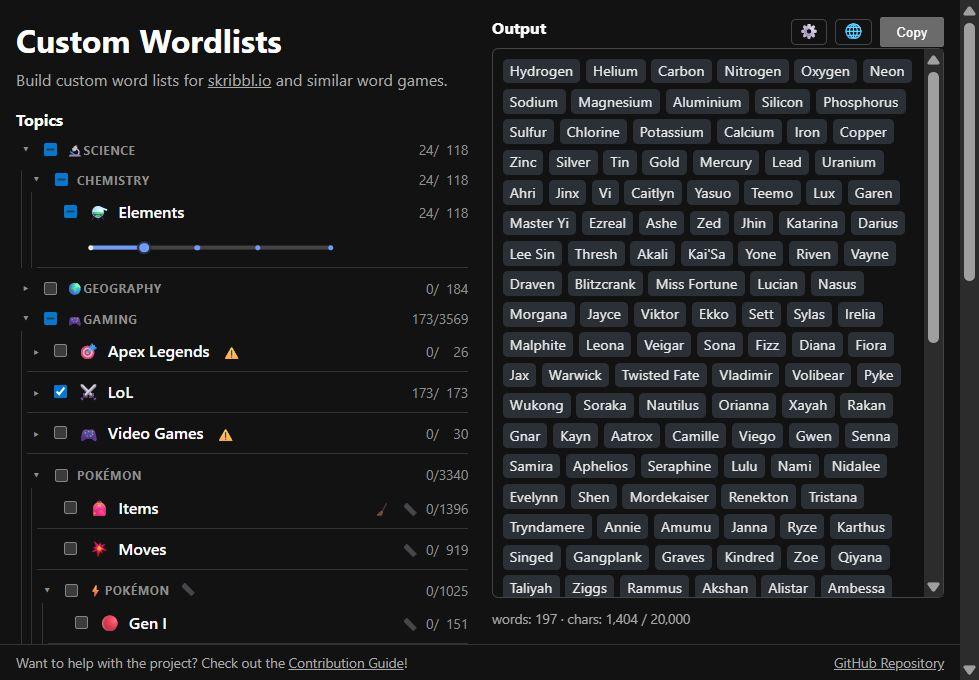

# Custom Wordlists

Build your own custom word lists for **[skribbl.io](https://skribbl.io)**, [Codenames](https://codenames.game/), and other word-based games, or use them as fodder to [spin a wheel](https://spinthewheel.app/editor)!  
Pick topics, tune the "fame ruler" based on your Group's knowledge on the topic, apply filters and copy a ready-to-paste list!

**▶ Live: <https://trummler12.github.io/custom-wordlists/>**



## What can you do?

- **Topics & Categories**: unfold Categories, select Topics and apply different filters.
- **Fame Ruler**: define how many items you like to include from most to least well known (note that the criteria used may vary in quality).
- **Name forms**: entries with a short/long name (e.g. *Cartman* / *Eric Cartman*) can be emitted preferably as short, long/full, or both at once.
- **Languages**: in addition to your (primary) language, you can also pick a _different_ language for the Interface in particular, as well as some other niche things to customize, for example:
  - **Per-list overrides**: choose a single list to use a secondary language instead, while the rest stay in your _primary_ language (useful for fictional works with a preferred Dub that's in a different Language than the rest).
  - **Variant readings**: read a Japanese list as romaji instead of its native script, or a Spanish one in its Latin American forms.
- **What a list leaves out** — a 🚫 panel names what items of each type a list filters out (numbered junk, things nobody could draw) and hands any of them back if you want them. Some other Elements like ✅ may technically do the same thing, but in an _inclusive_ manner instead.
- **skribbl-ready output**: de-duplicated, with live word/character counts and the skribbl limits checked for you.
- and **much more** to explore, such as the **Custom** section at the very bottom as well as **global** and also some **local settings**, **incomplete & planned Topics**
- and of course LOTS of things to be added in the future!

### Progress

The tool itself already does what it needs to, with smaller functional updates as ideas flow in;  
the word lists, however, are where we heavily depend on **help from the community** — see [Contributing](#contributing) below.

<!-- Replace with docs/Queries/README.md as soon as it's merged -->
[Here](docs/Topic-Progress.md) is **every topic planned** so far and how far along it is (for English, since other languages may trail behind by varying degrees).

### Future plans

The obvious next steps are
\- finishing the **lists** that are marked as incomplete or planned,
\- maybe extending some existing Topics with interesting new Subtypes some people might be interested to include,
\- and of course using the power of the community to do all sorts of updates to Wikidata items;
\- and not to forget: All [Languages Skribbl.io supports](https://skribbl-io.fandom.com/wiki/Supported_Languages) ought to also find support in the App's Interface at some point;

[Here](docs/Language-Roadmap.md) is the rough order in which those **languages** are meant to arrive.

## Contributing

Contributions are very welcome, and **you don't need to write any code.**  
Most lists are built from [Wikidata](https://www.wikidata.org/): one dump ideally already carries every supported and planned language at once; however, many names (labels) there are still missing, which is where you come in:

- **Improve the data on Wikidata (recommended).** Each topic built from it has a [coverage page](https://trummler12.github.io/custom-wordlists/coverage/sports) showing which names are still missing per language. Every one added there reaches the lists with the next dump update.
- **Propose a topic built from Wikidata**, ideally with a Query Builder link, via a [*Data source*](https://github.com/Trummler12/custom-wordlists/issues/new?template=1-data-source.yml) issue.
- **Hand-written lists** are still welcome for topics Wikidata can't carry, but they are the costly route for everyone.

See **[CONTRIBUTING.md](CONTRIBUTING.md)** for details.

## Local development

```bash
npm install
npm run dev        # dev server (http://localhost:5173)
npm run build      # production build => dist/
npm run validate   # check data/topics/** against the schema
npm run check      # type-check the frontend
npm test           # unit tests — CI runs this as its own gate
```

## How word lists are structured

Each topic is one JSON file under [`data/topics/**`](https://github.com/Trummler12/custom-wordlists/tree/main/data/topics), described by [`schema/topic.schema.json`](schema/topic.schema.json). Entries are usually built from three base forms:

- a **plain string** — `"Mr. Mackey"` — when it reads the same in every language & variant;
- a **`{short, long}` name pair** — `{"short": "Cartman", "long": "Eric Cartman"}` — for entries with both a common and a full name;
- a **language map** — `{"en": "Chef", "de": "Chefkoch"}` — for entries that differ between languages.

In some cases these forms combine: a language map may wrap around only the part that actually differs from English, so a name pair whose long form translates becomes  
`{"short": "Jesus", "long": {"en": "Jesus Christ", "de": "Jesus Christus"}}`.  
or if it was a non-family-name-based Topic with a lot more variety between languages, preferably  
`{"en": {"short": "Jesus", "long": "Jesus Christ"}, "de": {"short": "Jesus", "long": "Jesus Christus"}}`

See [`data/topics/animation/south-park/characters.json`](data/topics/animation/south-park/characters.json#L19) for a rather simple example of all important cases in one file.  
The manifest the app loads (`data/index.json`) is generated by the `build:index` step, which both `npm run dev` and `npm run build` run first.

Two further keys say something by being **absent**, which is worth knowing before editing a file by hand:

- a **variant tag** — `ja-Latn` (romaji), `es-419` (Latin American Spanish) — is written only where the variant spells a name differently, so no key means "the same as the language it varies from"; This logic also applies for _standard_ languages relative to English;
- **`?`** lists the languages an entry has no name in *at all*. It is needed because a missing key implicitly means "the same as English"; without it, a bulk import that stopped halfway would be asserting the English word as every other language's.

## Tech

Svelte 5 (runes) · Vite · TypeScript, deployed as a static site to GitHub Pages.

## License

The code is [MIT](LICENSE).

The word lists are collections of **names** — characters, creatures, places and the like — compiled from public sources: more and more of them from [Wikidata](https://www.wikidata.org/) (CC0), others from sources such as fandom wikis; no descriptions or other prose is copied from them. Ideally each topic file names its own sources in its `sources` field, and whoever compiled it in `credits` — that part is still work in progress. Many lists are only sketched out so far, with no source worth naming yet. If you hold rights to something here and would rather it weren't, open an issue and it comes out.
